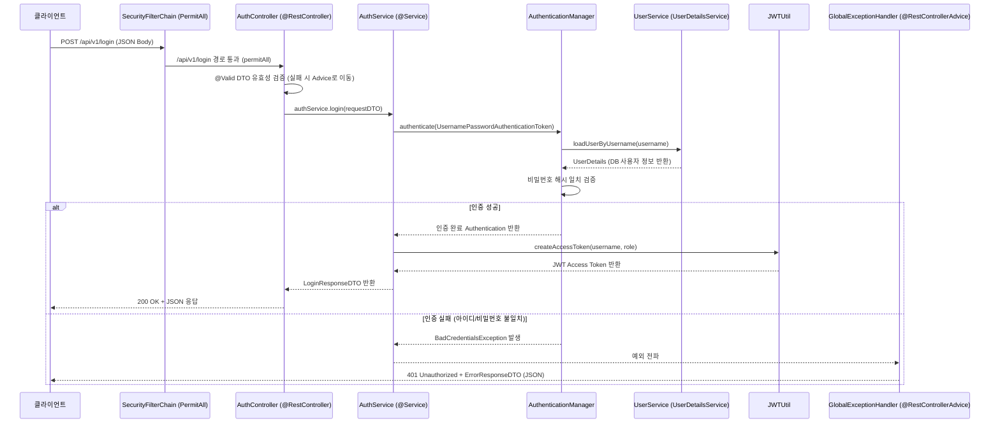

# 로그인 서비스(AuthService)에서 로그인 검증하는 방식 (Service 기반 로그인)

## 1. 개요

Spring Security에서 필터 체인을 통해 로그인을 가로채지 않고, 일반 REST API처럼 **Controller $\rightarrow$ Service 계층 구조**를 통해 로그인을 검증하고 JWT를 발급하는 방식입니다.

비즈니스 로직(인증, 토큰 생성)을 **`AuthService`**로 완전히 캡슐화하여 단일 책임 원칙(SRP)을 준수하고, Spring MVC의 핵심 기능인 **`@Valid` 입력 검증**, **`@RestControllerAdvice` 전역 예외 처리**, **Swagger(OpenAPI) 문서 자동화**를 완벽하게 활용할 수 있습니다.

---

## 2. 전체 아키텍처 및 동작 흐름



---

## 3. Swagger(Springdoc OpenAPI) 설정

### (1) 의존성 추가 (`build.gradle`)
Spring Boot 3.x / 4.x 환경에서는 `springdoc-openapi-starter-webmvc-ui`를 사용합니다.

```groovy
dependencies {
    // Swagger / OpenAPI 3.0
    implementation 'org.springdoc:springdoc-openapi-starter-webmvc-ui:2.8.5'
    
    // Validation (@Valid, @NotBlank 등)
    implementation 'org.springframework.boot:spring-boot-starter-validation'
}
```

---

## 4. 계층별 상세 구현 코드

### (1) DTO 정의 (Swagger 및 Validation 적용)

#### `LoginRequestDTO.java`
- `@Schema`: Swagger 문서에 필드 설명과 예시 데이터를 표시합니다.
- `@NotBlank`, `@Size`: Bean Validation을 통해 요청 바디의 유효성을 1차 검증합니다.

```java
package io.example.security_seven.api.dto;

import io.swagger.v3.oas.annotations.media.Schema;
import jakarta.validation.constraints.NotBlank;
import jakarta.validation.constraints.Size;

@Schema(description = "로그인 요청 데이터")
public record LoginRequestDTO(
        @Schema(description = "사용자 아이디", example = "hong123")
        @NotBlank(message = "아이디를 입력해주세요.")
        @Size(min = 4, max = 20, message = "아이디는 4자 이상 20자 이하이어야 합니다.")
        String username,

        @Schema(description = "비밀번호", example = "password123!")
        @NotBlank(message = "비밀번호를 입력해주세요.")
        @Size(min = 6, max = 30, message = "비밀번호는 6자 이상 30자 이하이어야 합니다.")
        String password
) {}
```

#### `LoginResponseDTO.java`
```java
package io.example.security_seven.api.dto;

import io.swagger.v3.oas.annotations.media.Schema;

@Schema(description = "로그인 응답 데이터 (JWT 토큰)")
public record LoginResponseDTO(
        @Schema(description = "토큰 타입", example = "Bearer")
        String grantType,

        @Schema(description = "발급된 Access Token", example = "eyJhbGciOiJIUzI1NiIsInR5cCI6IkpXVCJ9...")
        String accessToken
) {
    public static LoginResponseDTO of(String accessToken) {
        return new LoginResponseDTO("Bearer", accessToken);
    }
}
```

#### `ErrorResponseDTO.java` (공통 에러 응답)
```java
package io.example.security_seven.api.dto;

import io.swagger.v3.oas.annotations.media.Schema;
import java.time.LocalDateTime;
import java.util.Map;

@Schema(description = "에러 응답 규격")
public record ErrorResponseDTO(
        @Schema(description = "HTTP 상태 코드", example = "400")
        int status,

        @Schema(description = "에러 코드명", example = "BAD_REQUEST")
        String error,

        @Schema(description = "상세 메시지", example = "요청 값이 올바르지 않습니다.")
        String message,

        @Schema(description = "필드별 유효성 검증 실패 목록 (옵션)")
        Map<String, String> validationErrors,

        @Schema(description = "발생 일시")
        LocalDateTime timestamp
) {
    public static ErrorResponseDTO of(int status, String error, String message) {
        return new ErrorResponseDTO(status, error, message, null, LocalDateTime.now());
    }

    public static ErrorResponseDTO of(int status, String error, String message, Map<String, String> validationErrors) {
        return new ErrorResponseDTO(status, error, message, validationErrors, LocalDateTime.now());
    }
}
```

---

### (2) 비즈니스 로직: `AuthService.java`

- 인증 수행 및 JWT 토큰 발급의 핵심 비즈니스 로직을 전담합니다.
- `AuthenticationManager`를 호출하여 비밀번호 일치 여부와 회원 상태를 검증합니다.

```java
package io.example.security_seven.domain.user.service;

import io.example.security_seven.api.dto.LoginRequestDTO;
import io.example.security_seven.api.dto.LoginResponseDTO;
import io.example.security_seven.util.JWTUtil;
import org.springframework.security.authentication.AuthenticationManager;
import org.springframework.security.authentication.UsernamePasswordAuthenticationToken;
import org.springframework.security.core.Authentication;
import org.springframework.stereotype.Service;
import org.springframework.transaction.annotation.Transactional;

@Service
public class AuthService {

    private final AuthenticationManager authenticationManager;
    private final JWTUtil jwtUtil;

    public AuthService(AuthenticationManager authenticationManager, JWTUtil jwtUtil) {
        this.authenticationManager = authenticationManager;
        this.jwtUtil = jwtUtil;
    }

    /**
     * 로그인 검증 및 Access Token 발급
     * @param request 로그인 요청 DTO (username, password)
     * @return LoginResponseDTO (Bearer, accessToken)
     */
    @Transactional(readOnly = true)
    public LoginResponseDTO login(LoginRequestDTO request) {
        // 1. 미인증 토큰(UsernamePasswordAuthenticationToken) 생성
        UsernamePasswordAuthenticationToken authRequest =
                UsernamePasswordAuthenticationToken.unauthenticated(request.username(), request.password());

        // 2. AuthenticationManager를 통해 DB 검증 및 비밀번호 해시 일치 확인
        //    (불일치 시 내부에서 BadCredentialsException 자동 발생 -> GlobalExceptionHandler가 수신)
        Authentication authentication = authenticationManager.authenticate(authRequest);

        // 3. 인증된 사용자 정보에서 사용자명과 권한 추출
        String username = authentication.getName();
        String role = authentication.getAuthorities().iterator().next().getAuthority();

        // 4. JWT Access Token 발급
        String accessToken = jwtUtil.createAccessToken(username, role);

        return LoginResponseDTO.of(accessToken);
    }
}
```

---

### (3) 프레젠테이션 계층: `AuthController.java`

- Controller는 비즈니스 로직을 갖지 않고, **입력 검증(`@Valid`)**과 **Service 호출**, **Swagger 스펙 명세**만을 담당합니다.

```java
package io.example.security_seven.api;

import io.example.security_seven.api.dto.ErrorResponseDTO;
import io.example.security_seven.api.dto.LoginRequestDTO;
import io.example.security_seven.api.dto.LoginResponseDTO;
import io.example.security_seven.domain.user.service.AuthService;
import io.swagger.v3.oas.annotations.Operation;
import io.swagger.v3.oas.annotations.media.Content;
import io.swagger.v3.oas.annotations.media.Schema;
import io.swagger.v3.oas.annotations.responses.ApiResponse;
import io.swagger.v3.oas.annotations.responses.ApiResponses;
import io.swagger.v3.oas.annotations.tags.Tag;
import jakarta.validation.Valid;
import org.springframework.http.ResponseEntity;
import org.springframework.web.bind.annotation.PostMapping;
import org.springframework.web.bind.annotation.RequestBody;
import org.springframework.web.bind.annotation.RequestMapping;
import org.springframework.web.bind.annotation.RestController;

@Tag(name = "인증/인가 API", description = "로그인 및 토큰 발급 관련 API")
@RestController
@RequestMapping("/api/v1")
public class AuthController {

    private final AuthService authService;

    public AuthController(AuthService authService) {
        this.authService = authService;
    }

    @Operation(summary = "사용자 로그인", description = "아이디와 비밀번호를 검증한 후 JWT Access Token을 발급합니다.")
    @ApiResponses(value = {
            @ApiResponse(
                    responseCode = "200",
                    description = "로그인 성공",
                    content = @Content(schema = @Schema(implementation = LoginResponseDTO.class))
            ),
            @ApiResponse(
                    responseCode = "400",
                    description = "입력값 유효성 검증 실패 (빈 값, 글자 수 제한 등)",
                    content = @Content(schema = @Schema(implementation = ErrorResponseDTO.class))
            ),
            @ApiResponse(
                    responseCode = "401",
                    description = "인증 실패 (아이디 또는 비밀번호 불일치)",
                    content = @Content(schema = @Schema(implementation = ErrorResponseDTO.class))
            )
    })
    @PostMapping("/login")
    public ResponseEntity<LoginResponseDTO> login(@RequestBody @Valid LoginRequestDTO request) {
        LoginResponseDTO response = authService.login(request);
        return ResponseEntity.ok(response);
    }
}
```

---

### (4) 전역 예외 처리: `GlobalExceptionHandler.java` (`@RestControllerAdvice`)

- `@Valid` 검증 실패 시 발생하는 `MethodArgumentNotValidException`을 가로채어 각 필드별 상세 에러 메시지를 반환합니다.
- `AuthenticationManager`에서 던지는 `BadCredentialsException`, `UsernameNotFoundException`을 처리하여 통일된 401 JSON 포맷을 반환합니다.

```java
package io.example.security_seven.api.exception;

import io.example.security_seven.api.dto.ErrorResponseDTO;
import org.springframework.http.HttpStatus;
import org.springframework.http.ResponseEntity;
import org.springframework.security.authentication.BadCredentialsException;
import org.springframework.security.authentication.DisabledException;
import org.springframework.security.authentication.LockedException;
import org.springframework.security.core.userdetails.UsernameNotFoundException;
import org.springframework.validation.FieldError;
import org.springframework.web.bind.MethodArgumentNotValidException;
import org.springframework.web.bind.annotation.ExceptionHandler;
import org.springframework.web.bind.annotation.RestControllerAdvice;

import java.util.HashMap;
import java.util.Map;

@RestControllerAdvice
public class GlobalExceptionHandler {

    /**
     * 1. @Valid 유효성 검증 실패 처리 (400 Bad Request)
     */
    @ExceptionHandler(MethodArgumentNotValidException.class)
    public ResponseEntity<ErrorResponseDTO> handleValidationException(MethodArgumentNotValidException e) {
        Map<String, String> fieldErrors = new HashMap<>();
        for (FieldError fieldError : e.getBindingResult().getFieldErrors()) {
            fieldErrors.put(fieldError.getField(), fieldError.getDefaultMessage());
        }

        ErrorResponseDTO errorResponse = ErrorResponseDTO.of(
                HttpStatus.BAD_REQUEST.value(),
                HttpStatus.BAD_REQUEST.name(),
                "입력값 유효성 검증에 실패했습니다.",
                fieldErrors
        );
        return ResponseEntity.status(HttpStatus.BAD_REQUEST).body(errorResponse);
    }

    /**
     * 2. 인증 실패 처리 (401 Unauthorized)
     * 보안상 아이디가 틀렸는지 비밀번호가 틀렸는지 구분하지 않고 통일된 메시지를 제공합니다.
     */
    @ExceptionHandler({BadCredentialsException.class, UsernameNotFoundException.class})
    public ResponseEntity<ErrorResponseDTO> handleAuthenticationException(Exception e) {
        ErrorResponseDTO errorResponse = ErrorResponseDTO.of(
                HttpStatus.UNAUTHORIZED.value(),
                HttpStatus.UNAUTHORIZED.name(),
                "아이디 또는 비밀번호가 올바르지 않습니다."
        );
        return ResponseEntity.status(HttpStatus.UNAUTHORIZED).body(errorResponse);
    }

    /**
     * 3. 계정 잠김 / 비활성화 처리 (403 Forbidden)
     */
    @ExceptionHandler({LockedException.class, DisabledException.class})
    public ResponseEntity<ErrorResponseDTO> handleAccountStatusException(Exception e) {
        ErrorResponseDTO errorResponse = ErrorResponseDTO.of(
                HttpStatus.FORBIDDEN.value(),
                HttpStatus.FORBIDDEN.name(),
                "계정이 잠겨있거나 비활성화되었습니다. 관리자에게 문의하세요."
        );
        return ResponseEntity.status(HttpStatus.FORBIDDEN).body(errorResponse);
    }

    /**
     * 4. 기타 서버 내부 오류 (500 Internal Server Error)
     */
    @ExceptionHandler(Exception.class)
    public ResponseEntity<ErrorResponseDTO> handleGeneralException(Exception e) {
        ErrorResponseDTO errorResponse = ErrorResponseDTO.of(
                HttpStatus.INTERNAL_SERVER_ERROR.value(),
                HttpStatus.INTERNAL_SERVER_ERROR.name(),
                "서버 내부 오류가 발생했습니다: " + e.getMessage()
        );
        return ResponseEntity.status(HttpStatus.INTERNAL_SERVER_ERROR).body(errorResponse);
    }
}
```

---

### (5) `SecurityConfig.java` 수정

- 커스텀 로그인 필터와 핸들러 설정이 완전히 제거되어 시큐리티 설정이 직관적이고 깔끔해집니다.
- 로그인/회원가입 경로 및 **Swagger UI 경로(`/swagger-ui/**`, `/v3/api-docs/**`)**를 `permitAll()` 처리합니다.

```java
package io.example.security_seven.config;

import org.springframework.context.annotation.Bean;
import org.springframework.context.annotation.Configuration;
import org.springframework.security.authentication.AuthenticationManager;
import org.springframework.security.config.annotation.authentication.configuration.AuthenticationConfiguration;
import org.springframework.security.config.annotation.web.builders.HttpSecurity;
import org.springframework.security.config.annotation.web.configurers.AbstractHttpConfigurer;
import org.springframework.security.config.http.SessionCreationPolicy;
import org.springframework.security.crypto.bcrypt.BCryptPasswordEncoder;
import org.springframework.security.crypto.password.PasswordEncoder;
import org.springframework.security.web.SecurityFilterChain;

@Configuration
public class SecurityConfig {

    /**
     * AuthService에서 사용할 AuthenticationManager를 Bean으로 노출
     */
    @Bean
    public AuthenticationManager authenticationManager(AuthenticationConfiguration authenticationConfiguration) {
        return authenticationConfiguration.getAuthenticationManager();
    }

    @Bean
    public SecurityFilterChain securityFilterChain(HttpSecurity httpSecurity) {
        httpSecurity
                .csrf(AbstractHttpConfigurer::disable)
                .formLogin(AbstractHttpConfigurer::disable)
                .httpBasic(AbstractHttpConfigurer::disable)
                .sessionManagement(session -> session
                        .sessionCreationPolicy(SessionCreationPolicy.STATELESS))
                .authorizeHttpRequests(auth -> auth
                        // 1. 로그인, 회원가입 등 공개 엔드포인트
                        .requestMatchers("/api/v1/login", "/api/v1/join").permitAll()
                        // 2. Swagger / OpenAPI 명세 엔드포인트 개방
                        .requestMatchers("/swagger-ui/**", "/v3/api-docs/**", "/swagger-ui.html").permitAll()
                        // 3. 그 외 모든 요청은 인증 필요
                        .anyRequest().authenticated()
                );

        // ※ 실제 인가 처리가 필요할 때는 매 요청마다 헤더의 JWT를 검사하는
        //   JwtAuthorizationFilter (OncePerRequestFilter) 1개만 여기에 배치합니다.
        // httpSecurity.addFilterBefore(jwtAuthorizationFilter, UsernamePasswordAuthenticationFilter.class);

        return httpSecurity.build();
    }

    @Bean
    public PasswordEncoder passwordEncoder() {
        return new BCryptPasswordEncoder();
    }
}
```

---

## 5. 결론 및 실무적 이점

1. **책임의 명확한 분리 (Separation of Concerns)**:
   - **`AuthController`**: HTTP 파라미터 매핑, `@Valid` 검증, Swagger 문서화
   - **`AuthService`**: `AuthenticationManager` 기반 검증, JWT 토큰 발급 비즈니스 로직
   - **`GlobalExceptionHandler`**: 유효성 검증 실패(400) 및 인증 실패(401) 전역 응답 처리
2. **생산성 및 유지보수성**:
   - `request.getInputStream()` 스트림을 직접 파싱하지 않으므로 코드가 간결합니다.
   - `FilterRegistrationBean` 같은 서블릿 컨테이너 레벨의 필터 등록 이슈를 전혀 신경 쓸 필요가 없습니다.
   - Swagger 문서를 통해 프론트엔드 개발자와 즉시 API 명세를 공유하고 테스트할 수 있습니다.
