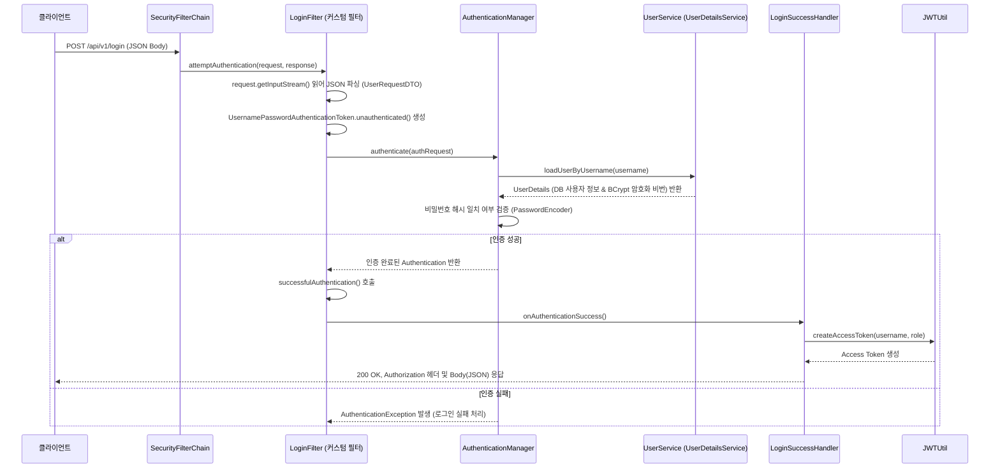

# 커스텀 인증 필터를 구현하여 로그인 검증하는 방식 (Filter 기반 로그인)

## 1. 개요

Spring Security의 기본 폼 로그인(`formLogin`)은 HTML Form 기반(`application/x-www-form-urlencoded`) 요청을 처리하도록 설계되어 있습니다.

본 프로젝트(`security-seven`)는 REST API 환경에 맞추어 클라이언트가 **JSON(`application/json`)** 형식으로 전송한 로그인 요청(`username`, `password`)을 처리하기 위해, `AbstractAuthenticationProcessingFilter`를 상속한 **커스텀 `LoginFilter`**를 구현하여 시큐리티 필터 체인에 등록하는 방식을 사용하고 있습니다.

---

## 2. 전체 동작 흐름 (Architecture)



---

## 3. 프로젝트 실제 구현 코드

현재 `security-seven` 프로젝트에 구현된 실제 소스 코드 구조입니다.

### (1) 요청 DTO
- **파일 위치**: [`io/example/security_seven/domain/user/entity/UserRequestDTO.java`](file:///d:/project-refference/spring-security-seven-workspace/security-seven/src/main/java/io/example/security_seven/domain/user/entity/UserRequestDTO.java)
- Java `record`를 사용하여 로그인 및 회원가입 시 요청 데이터를 전달받습니다.

```java
package io.example.security_seven.domain.user.entity;

public record UserRequestDTO(String username, String password) {}
```

---

### (2) 커스텀 로그인 필터
- **파일 위치**: [`io/example/security_seven/filter/LoginFilter.java`](file:///d:/project-refference/spring-security-seven-workspace/security-seven/src/main/java/io/example/security_seven/filter/LoginFilter.java)
- `AbstractAuthenticationProcessingFilter`를 상속하여 `POST /api/v1/login` 요청을 가로채 인증을 수행합니다.
- `StreamUtils`와 `ObjectMapper`를 사용하여 Request Body의 JSON 문자열을 `UserRequestDTO`로 역직렬화합니다.

```java
package io.example.security_seven.filter;

import io.example.security_seven.domain.user.entity.UserRequestDTO;
import jakarta.servlet.FilterChain;
import jakarta.servlet.ServletException;
import jakarta.servlet.ServletInputStream;
import jakarta.servlet.http.HttpServletRequest;
import jakarta.servlet.http.HttpServletResponse;
import org.springframework.http.HttpMethod;
import org.springframework.security.authentication.AuthenticationManager;
import org.springframework.security.authentication.AuthenticationServiceException;
import org.springframework.security.authentication.UsernamePasswordAuthenticationToken;
import org.springframework.security.core.Authentication;
import org.springframework.security.core.AuthenticationException;
import org.springframework.security.web.authentication.AbstractAuthenticationProcessingFilter;
import org.springframework.security.web.authentication.AuthenticationSuccessHandler;
import org.springframework.security.web.servlet.util.matcher.PathPatternRequestMatcher;
import org.springframework.security.web.util.matcher.RequestMatcher;
import org.springframework.util.StreamUtils;
import tools.jackson.databind.ObjectMapper;

import java.io.IOException;
import java.nio.charset.StandardCharsets;

public class LoginFilter extends AbstractAuthenticationProcessingFilter {

    // POST /api/v1/login 요청 경로 매칭
    private static final RequestMatcher DEFAULT_ANT_PATH_REQUEST_MATCHER =
            PathPatternRequestMatcher.withDefaults()
            .matcher(HttpMethod.POST, "/api/v1/login");

    private final AuthenticationSuccessHandler authenticationSuccessHandler;

    public LoginFilter(
            AuthenticationManager authenticationManager,
            AuthenticationSuccessHandler authenticationSuccessHandler
    ) {
        super(DEFAULT_ANT_PATH_REQUEST_MATCHER, authenticationManager);
        this.authenticationSuccessHandler = authenticationSuccessHandler;
        setAuthenticationSuccessHandler(authenticationSuccessHandler);
    }

    @Override
    public Authentication attemptAuthentication(HttpServletRequest request, HttpServletResponse response)
            throws AuthenticationException {

        // 1. HTTP 메서드 체크
        if (!request.getMethod().equals("POST")) {
            throw new AuthenticationServiceException("Authentication method not supported: " + request.getMethod());
        }

        try {
            // 2. 요청 본문(JSON) 읽기 및 DTO 매핑
            ObjectMapper objectMapper = new ObjectMapper();
            ServletInputStream inputStream = request.getInputStream();
            String messageBody = StreamUtils.copyToString(inputStream, StandardCharsets.UTF_8);

            UserRequestDTO userRequestDTO = objectMapper.readValue(messageBody, UserRequestDTO.class);

            String username = userRequestDTO.username();
            String password = userRequestDTO.password();

            // 3. 미인증 토큰 생성
            UsernamePasswordAuthenticationToken authRequest =
                    UsernamePasswordAuthenticationToken.unauthenticated(username, password);
            this.setDetails(request, authRequest);

            // 4. AuthenticationManager에 인증 위임
            return this.getAuthenticationManager().authenticate(authRequest);

        } catch (IOException e) {
            throw new RuntimeException(e);
        }
    }

    protected void setDetails(HttpServletRequest request, UsernamePasswordAuthenticationToken authRequest) {
        authRequest.setDetails(this.authenticationDetailsSource.buildDetails(request));
    }

    // 5. 인증 성공 시 SuccessHandler 호출
    @Override
    protected void successfulAuthentication(HttpServletRequest request, HttpServletResponse response, FilterChain chain,
                                            Authentication authResult) throws IOException, ServletException {
        authenticationSuccessHandler.onAuthenticationSuccess(request, response, authResult);
    }
}
```

---

### (3) 인증 성공 핸들러
- **파일 위치**: [`io/example/security_seven/handler/LoginSuccessHandler.java`](file:///d:/project-refference/spring-security-seven-workspace/security-seven/src/main/java/io/example/security_seven/handler/LoginSuccessHandler.java)
- 인증이 성공하면 `Authentication` 객체에서 사용자명과 권한(Role)을 꺼내 JWT Access Token을 발급합니다.
- `Authorization` 응답 헤더 및 Body(JSON)로 토큰을 반환합니다.

```java
package io.example.security_seven.handler;

import io.example.security_seven.util.JWTUtil;
import jakarta.servlet.ServletException;
import jakarta.servlet.http.HttpServletRequest;
import jakarta.servlet.http.HttpServletResponse;
import org.springframework.security.core.Authentication;
import org.springframework.security.core.GrantedAuthority;
import org.springframework.security.web.authentication.AuthenticationSuccessHandler;
import org.springframework.stereotype.Component;

import java.io.IOException;

@Component
public class LoginSuccessHandler implements AuthenticationSuccessHandler {

    private final JWTUtil jwtUtil;

    public LoginSuccessHandler(JWTUtil jwtUtil) {
        this.jwtUtil = jwtUtil;
    }

    @Override
    public void onAuthenticationSuccess(HttpServletRequest request, HttpServletResponse response,
                                        Authentication authentication) throws IOException {
        String username = authentication.getName();
        // role 첫번째 정보 추출
        String role = authentication.getAuthorities().iterator().next().getAuthority();

        // JWT Access Token 생성
        String accessToken = jwtUtil.createAccessToken(username, role);

        // Header 및 Body에 응답
        response.setHeader("Authorization", "Bearer " + accessToken);
        response.setContentType("application/json");
        response.setCharacterEncoding("UTF-8");
        String json = String.format("{\"accessToken\":\"%s\"}", accessToken);
        response.getWriter().write(json);
        response.getWriter().flush();
    }
}
```

---

### (4) JWT 유틸리티
- **파일 위치**: [`io/example/security_seven/util/JWTUtil.java`](file:///d:/project-refference/spring-security-seven-workspace/security-seven/src/main/java/io/example/security_seven/util/JWTUtil.java)
- JJWT 라이브러리를 사용하여 SecretKey 서명 및 토큰 만료시간을 관리합니다.

```java
package io.example.security_seven.util;

import io.jsonwebtoken.Claims;
import io.jsonwebtoken.Jwts;
import io.jsonwebtoken.security.Keys;
import org.springframework.beans.factory.annotation.Value;
import org.springframework.stereotype.Component;

import javax.crypto.SecretKey;
import java.nio.charset.StandardCharsets;
import java.util.Date;

@Component
public class JWTUtil {

    private final SecretKey key;
    private final long accessTokenExpireTime;

    public JWTUtil (@Value("${jwt.secret}") String secret,
                    @Value("${jwt.access-token-expire-time}") long accessTokenExpireTime) {
        this.key = Keys.hmacShaKeyFor(secret.getBytes(StandardCharsets.UTF_8));
        this.accessTokenExpireTime = accessTokenExpireTime;
    }

    public String createAccessToken(String username, String role) {
        Date now = new Date();
        Date expireDate = new Date(now.getTime() + accessTokenExpireTime);
        return Jwts.builder()
                .subject(username)
                .claim("role", role)
                .claim("tokenType", "ACCESS")
                .issuedAt(now)
                .expiration(expireDate)
                .signWith(key)
                .compact();
    }

    public Claims getClaims(String token) {
        return Jwts.parser()
                .verifyWith(key)
                .build()
                .parseSignedClaims(token)
                .getPayload();
    }
}
```

---

### (5) 시큐리티 설정
- **파일 위치**: [`io/example/security_seven/config/SecurityConfig.java`](file:///d:/project-refference/spring-security-seven-workspace/security-seven/src/main/java/io/example/security_seven/config/SecurityConfig.java)
- `new LoginFilter(...)`를 생성하여 `UsernamePasswordAuthenticationFilter` 직전에 배치합니다.

```java
package io.example.security_seven.config;

import io.example.security_seven.filter.LoginFilter;
import io.example.security_seven.handler.LoginSuccessHandler;
import org.springframework.boot.web.servlet.FilterRegistrationBean;
import org.springframework.context.annotation.Bean;
import org.springframework.context.annotation.Configuration;
import org.springframework.security.authentication.AuthenticationManager;
import org.springframework.security.config.annotation.authentication.configuration.AuthenticationConfiguration;
import org.springframework.security.config.annotation.web.builders.HttpSecurity;
import org.springframework.security.config.annotation.web.configurers.AbstractHttpConfigurer;
import org.springframework.security.config.http.SessionCreationPolicy;
import org.springframework.security.crypto.bcrypt.BCryptPasswordEncoder;
import org.springframework.security.crypto.password.PasswordEncoder;
import org.springframework.security.web.SecurityFilterChain;
import org.springframework.security.web.authentication.UsernamePasswordAuthenticationFilter;

@Configuration
public class SecurityConfig {

    private final AuthenticationConfiguration authenticationConfiguration;
    private final LoginSuccessHandler loginSuccessHandler;

    public SecurityConfig(
            AuthenticationConfiguration authenticationConfiguration,
            LoginSuccessHandler loginSuccessHandler
    ) {
        this.authenticationConfiguration = authenticationConfiguration;
        this.loginSuccessHandler = loginSuccessHandler;
    }

    @Bean
    public AuthenticationManager authenticationManager(AuthenticationConfiguration authenticationConfiguration) {
        return authenticationConfiguration.getAuthenticationManager();
    }

    @Bean
    public SecurityFilterChain securityFilterChain(HttpSecurity httpSecurity) {
        // CSRF 비활성화 (Stateless JWT 기반)
        httpSecurity
                .csrf(AbstractHttpConfigurer::disable);

        // 경로별 인가
        httpSecurity
                .authorizeHttpRequests(auth ->
                        auth.requestMatchers("/**").permitAll());

        // 세션 무상태(Stateless) 설정
        httpSecurity
                .sessionManagement(session -> session
                        .sessionCreationPolicy(SessionCreationPolicy.STATELESS));

        // 기본 폼 로그인 비활성화
        httpSecurity
                .formLogin(AbstractHttpConfigurer::disable);

        // [핵심] 커스텀 로그인 필터를 new로 직접 생성하여 시큐리티 체인에만 등록
        httpSecurity
                .addFilterBefore(
                        new LoginFilter(authenticationManager(authenticationConfiguration), loginSuccessHandler),
                        UsernamePasswordAuthenticationFilter.class
                );

        return httpSecurity.build();
    }
    
    @Bean
    public PasswordEncoder passwordEncoder() {
        return new BCryptPasswordEncoder();
    }
}
```

---

## 4. 본 프로젝트 구현 시 핵심 포인트

1. **`new LoginFilter(...)` 방식 적용**:
   - `LoginFilter`를 스프링 빈(`@Component` / `@Bean`)으로 만들지 않고 `SecurityFilterChain`에서 `new`로 직접 생성하여 등록했습니다.
   - 이로 인해 Tomcat 서블릿 컨테이너가 필터를 가로채서 서블릿 필터 체인에 이중 등록하는 문제를 원천적으로 방지합니다.

2. **`FilterRegistrationBean` 정리**:
   - `LoginFilter`가 빈이 아니므로 `FilterRegistrationBean<LoginFilter>` 메서드를 남겨두면 주입할 빈을 찾지 못해 부트 기동 오류(`UnsatisfiedDependencyException`)가 발생합니다. `new` 방식을 사용할 때는 해당 빈 설정을 제거하거나 주석 처리해야 합니다.

3. **향후 확장할 부분 (인가 필터)**:
   - 현재 구현된 `LoginFilter`는 로그인 시도(`POST /api/v1/login`) 시에만 동작합니다.
   - 이후 로그인된 사용자가 일반 API 요청 시 보낸 `Authorization: Bearer <token>`을 검증하려면, `OncePerRequestFilter`를 상속한 **`JwtFilter` (JWT 검증/인가 필터)**를 추가로 구현하여 체인에 등록해야 합니다.
